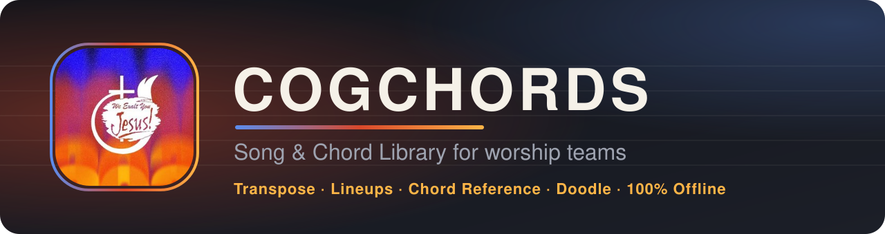
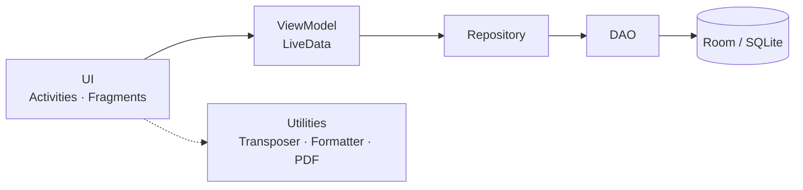
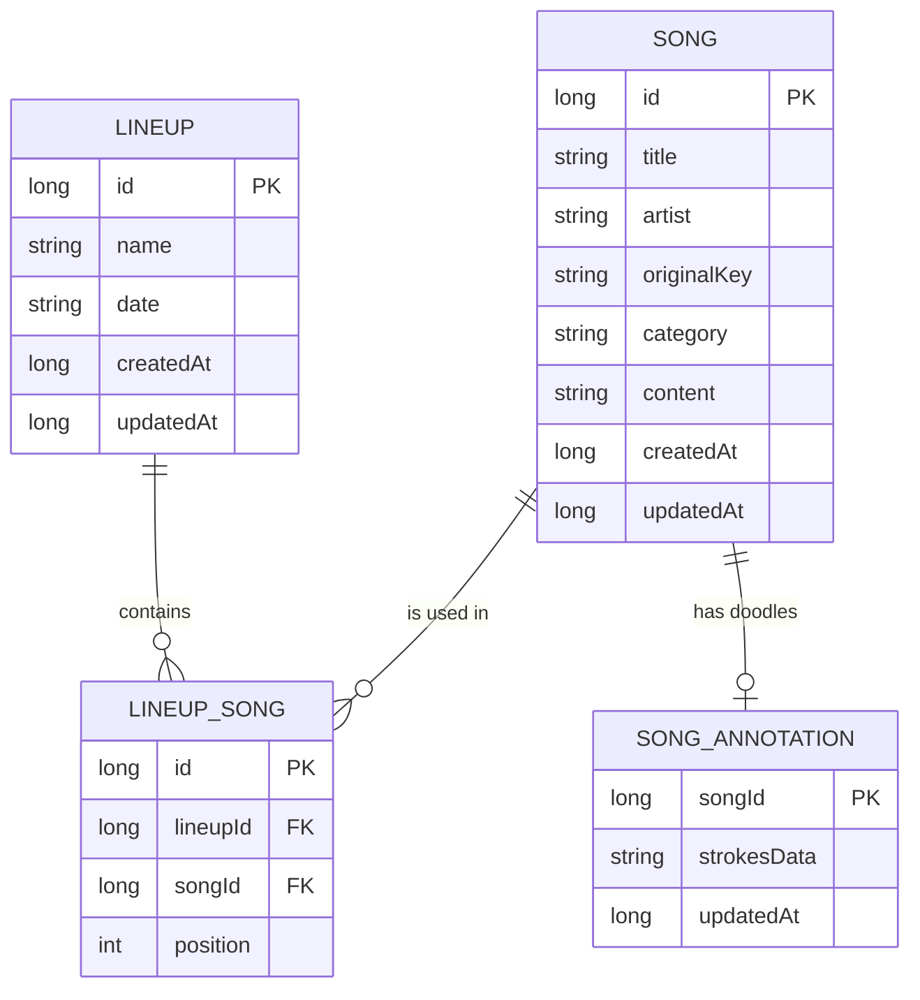

<div align="center">



<br/>

**Your worship team's songbook, key changer and setlist planner.**<br/>
Offline. No account. No permissions.

<br/>


[Features](#features) · [Getting Started](#getting-started) · [User Guide](#user-guide) · [Architecture](#architecture) · [Troubleshooting](#troubleshooting)

</div>

<br/>

## About

COGChords is an Android app for worship teams, musicians and singers. Keep every song with its lyrics and chords in one searchable library, transpose to any key in a tap, build lineups for each service, and read it all on stage with a clean chord sheet that scrolls while you play.

- **Private.** Everything lives on your phone.
- **Stage-ready.** Large chords, screen stays awake, hands-free auto-scroll.
- **Themed.** Four looks, from a dark gig mode to a bright paper songbook.

On first launch, an empty library is filled with 5 sample songs so you can try everything right away.

<br/>

## Features

| Feature | Description |
|---|---|
| **Song library** | Add, edit, delete and search by title or artist. Each song has an original key and a category. |
| **Chord sheets** | Chords above lyrics, or inline `[G]chords`. Section headers like `[Verse 1]` are highlighted. |
| **Transpose** | Shift by semitones, with original and current key shown. Handles slash chords like `D/F#`. |
| **Text size** | Zoom the sheet to fit your music stand or eyesight. |
| **Auto-scroll** | Adjustable speed. Touch to pause. Stops at the end of the song. |
| **Controls drawer** | Transpose, size and scroll tuck behind one button. |
| **Doodle notes** | Pen, marker and eraser in 5 colors with undo and clear. Saved with the song. |
| **Lineups** | Name, date and an ordered setlist, with PREV / NEXT in performance mode. |
| **Chord reference** | Guitar diagrams and piano keys. Search by name or filter by root. |
| **Import** | Songs from PDF, Word (.docx) or .txt. Chord positions are rebuilt and the key is guessed. |
| **Export & share** | A4 PDF (black on white, in your chosen key) or a full JSON backup. |
| **Themes** | Dark Stage, Clean Paper, Vibrant & Playful, Rainbow Spectrum. |

<!--
SCREENSHOTS (uncomment after adding images to docs/screenshots/)

## Screenshots

| Songs | Song view | Lineups | Chords |
|:---:|:---:|:---:|:---:|
|  |  |  |  |
-->

<br/>

## Getting Started

**Requirements**

- [Android Studio](https://developer.android.com/studio) (recent stable)
- Android SDK 36 (*Tools → SDK Manager*)
- JDK 21 (downloaded by Gradle's toolchain, or use Android Studio's bundled JDK)
- An Android 8.0+ phone or emulator

**Run**

```bash
git clone https://github.com/GhostFranccczx/COGChords_Android.git
cd COGChords_Android
```

1. In Android Studio, choose **File → Open** and select the folder containing `settings.gradle`.
2. Wait for Gradle sync to finish. The first sync takes a few minutes.
3. Pick a device and press **Run ▶**.

**Build an APK**

```bash
./gradlew assembleDebug        # macOS / Linux
gradlew.bat assembleDebug      # Windows
```

Output: `app/build/outputs/apk/debug/COGChords.apk`. Android may ask you to allow installs from unknown sources.

<br/>

## User Guide

<details open>
<summary><b>Add a song</b></summary>
<br/>

1. On the **Songs** tab, tap **+**.
2. Fill in title, artist, original key and category.
3. Paste or type lyrics with chords, then tap **SAVE**.

Both formats work, and you can mix them.

```text
[Verse 1]
G             C         G
Amazing grace how sweet the sound
               D
That saved a wretch like me
```

```text
[Verse 1]
[G]Amazing grace how [C]sweet the [G]sound
That [D]saved a wretch like [G]me
```

Put section names in brackets on their own line: `[Intro]`, `[Verse 1]`, `[Chorus]`, `[Bridge]`, `[Outro]`.

</details>

<details>
<summary><b>Play on stage</b></summary>
<br/>

Tap a song to open it. The screen stays awake.

- Open the **controls drawer** (sliders icon) to change key, text size and scroll speed.
- **− / +** shifts one semitone. **RESET** returns to the original key.
- **▶ PLAY** starts auto-scroll. Touch the lyrics to pause.

</details>

<details>
<summary><b>Draw notes</b></summary>
<br/>

1. Tap the **brush** icon.
2. Choose **PEN**, **MARKER** or **ERASER**, then a color.
3. Draw over the lyrics. Use **UNDO** or **CLEAR** as needed.
4. Tap **DONE**. Doodles are saved with the song.

</details>

<details>
<summary><b>Plan a lineup</b></summary>
<br/>

1. Open the **Lineups** tab and tap **+**.
2. Enter an event name and date.
3. Tap **+ ADD SONGS** and pick from your library.
4. Reorder with the arrows, then **SAVE**.
5. Open the lineup, tap a song, and use **◀ PREV** / **NEXT ▶** to move through the setlist.

</details>

<details>
<summary><b>Look up a chord</b></summary>
<br/>

Open the **Chords** tab. Search by name or tap a root-note chip, and toggle between guitar and piano.

</details>

<details>
<summary><b>Import from PDF, Word or text</b></summary>
<br/>

1. In the add-song screen, tap **IMPORT FROM PDF / WORD**.
2. Choose a `.pdf`, `.docx` or `.txt` file.
3. Review the lyrics, chords and key before saving.

> Only PDFs with real text work. Scans and photos need OCR.

</details>

<details>
<summary><b>Share and back up</b></summary>
<br/>

- **Share a PDF:** open a song and tap the share icon. It uses your current key.
- **Back up:** *Settings → Export & Share Library* creates a `.json` file.
- **Restore or merge:** *Settings → Import Songs from JSON*, or open a `.json` from WhatsApp or your file manager. New songs are added, and songs with the same title are updated.

</details>

<details>
<summary><b>Themes</b></summary>
<br/>

Go to **Settings → Theme Mode**.

| Theme | Best for |
|---|---|
| Dark Stage | Gigs and late-night practice |
| Clean Paper | A bright, songbook feel |
| Vibrant & Playful | Beginners and kids |
| Rainbow Spectrum | If you are unique |

</details>

<details>
<summary><b>JSON library format</b></summary>
<br/>

```json
[
  {
    "title": "Amazing Grace",
    "artist": "John Newton",
    "originalKey": "G",
    "category": "Hymn",
    "content": "[Verse 1]\nG             C         G\nAmazing grace how sweet the sound"
  }
]
```

Only `title` is required. Use `\n` for line breaks in `content`.

</details>

<br/>

## Tech Stack

| | |
|---|---|
| **Language** | Java 11 |
| **Platform** | Android, min SDK 26, target / compile SDK 36 |
| **UI** | Views (XML), Fragments, RecyclerView, ConstraintLayout, Material Components 1.14 (Material 3) |
| **Architecture** | MVVM with ViewModel, LiveData and Repository |
| **Database** | Room 2.6.1 on SQLite, schema v3 |
| **PDF** | [PdfBox-Android](https://github.com/TomRoush/PdfBox-Android) 2.0.27.0 for reading, built-in `PdfDocument` for writing |
| **Custom views** | `ChordDiagramView`, `PianoDiagramView`, `DrawingView` |
| **Build** | Gradle 9.5, AGP 9.3, version catalog, JDK 21 toolchain |
| **Testing** | JUnit 4, AndroidX Test, Espresso |

<details>
<summary><b>Library versions</b></summary>
<br/>

| Library | Version |
|---|---|
| `androidx.appcompat` | 1.8.0 |
| `com.google.android.material` | 1.14.0 |
| `androidx.activity` | 1.13.0 |
| `androidx.constraintlayout` | 2.2.2 |
| `androidx.recyclerview` | 1.3.2 |
| `androidx.room` | 2.6.1 |
| `androidx.lifecycle` | 2.8.7 |
| `com.tom-roush:pdfbox-android` | 2.0.27.0 |

</details>

<br/>

## Architecture

Layered MVVM. Screens never touch the database directly.



<details>
<summary><b>Data model</b></summary>
<br/>



</details>

<details>
<summary><b>Project structure</b></summary>
<br/>

```text
COGChords_Android/
├── app/src/main/
│   ├── java/com/example/cogchords/
│   │   ├── MainActivity.java            # Bottom navigation host
│   │   ├── COGChordsApp.java            # Applies the selected theme
│   │   ├── data/
│   │   │   ├── AppDatabase.java         # Room database + migrations
│   │   │   ├── dao/                     # Queries
│   │   │   ├── entity/                  # Song, Lineup, LineupSong, SongAnnotation
│   │   │   ├── model/                   # Query result models
│   │   │   └── repository/              # Data access for the UI
│   │   ├── ui/
│   │   │   ├── songs/                   # Library, song view, editor, doodles
│   │   │   ├── lineups/                 # List, editor, performance view
│   │   │   ├── chords/                  # Guitar and piano reference
│   │   │   └── settings/                # Themes, import/export, about
│   │   └── util/
│   │       ├── ChordTransposer.java
│   │       ├── SongFormatter.java
│   │       ├── ThemeManager.java
│   │       ├── SongTextImporter.java
│   │       ├── PdfTextExtractor.java
│   │       ├── PdfLayoutReconstructor.java
│   │       ├── SongPdfExporter.java
│   │       ├── SongJsonHelper.java
│   │       └── ChordDictionary.java, PianoChord.java, DoodleCodec.java ...
│   ├── assets/songs.json                # Starter songs
│   └── res/                             # Layouts, themes, colors, icons
├── docs/banner.svg
├── gradle/libs.versions.toml
└── build.gradle, settings.gradle
```

</details>

<br/>

## Troubleshooting

<details>
<summary><b>"Module not specified" when running</b></summary>
<br/>

Android Studio has not linked the Gradle project.

1. Right-click `build.gradle` and choose **Link Gradle Project**.
2. Or reopen via **File → Open**, selecting the folder with `settings.gradle`.

</details>

<details>
<summary><b>Gradle sync fails with a JDK error</b></summary>
<br/>

- Remove any `org.gradle.java.home=...` line from `gradle.properties`. That path only exists on one machine.
- Set **Settings → Build Tools → Gradle → Gradle JDK** to JDK 21 or Android Studio's embedded JDK.

</details>

<details>
<summary><b>PDF import returns no text</b></summary>
<br/>

The PDF is likely a scan or photo. Export the song as a PDF from a text editor or Word, or import a `.docx` or `.txt` instead.

</details>

<details>
<summary><b>Chords look misaligned after import</b></summary>
<br/>

Import is a best-effort rebuild. Open the song in the editor, fix spacing and chords by hand, then save.

</details>

<div align="center">

Made with ♥ for worship teams everywhere.<br/>
<sub>Developed by the COGChords Team</sub>

</div>
