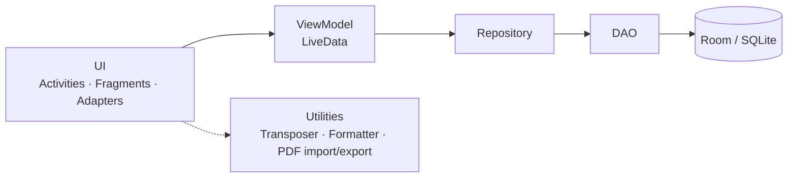
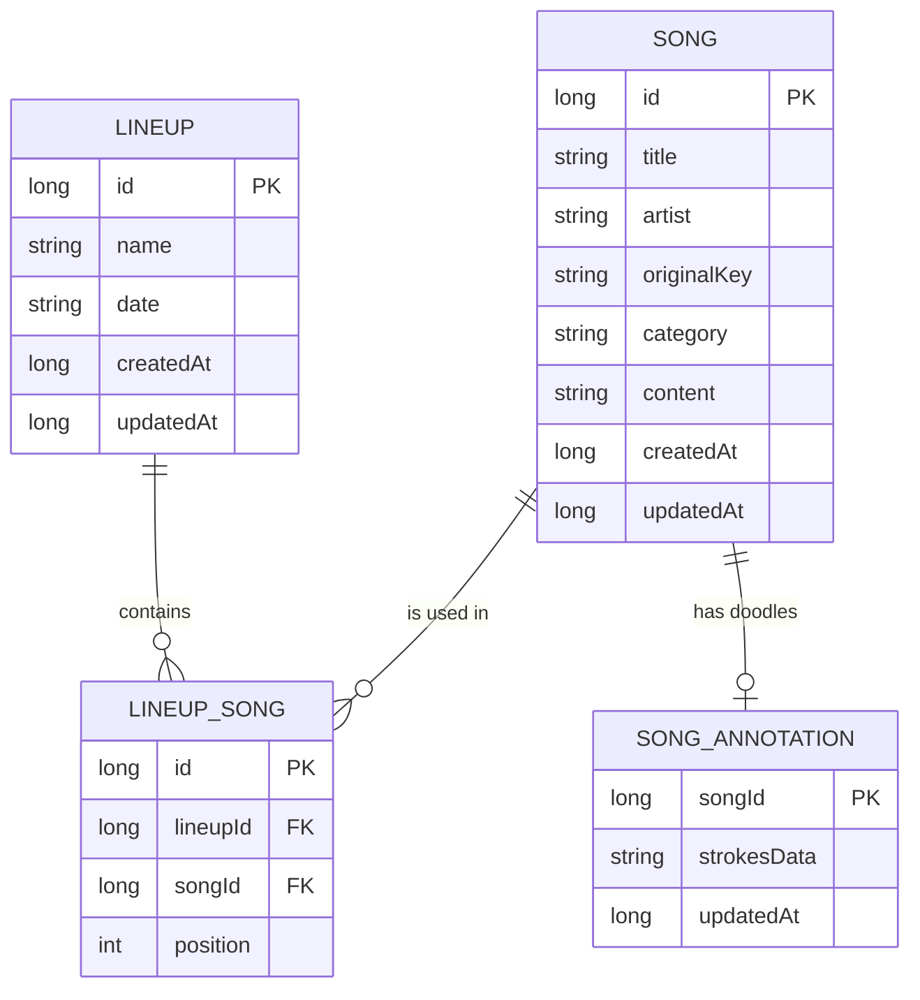

<div align="center">


<br/>


**Your worship team's songbook, key changer and setlist planner, all in one pocket-sized app.**

[Features](#-features) · [Tech Stack](#-tech-stack) · [Getting Started](#-getting-started) · [User Guide](#-user-guide) · [Architecture](#-architecture) · [Troubleshooting](#-troubleshooting)

</div>

---

## 📖 About

**COGChords** is an Android app for worship teams, musicians and singers. Keep every song with its lyrics and chords in one searchable library, **transpose** to any key in a tap, build **lineups** for each service or rehearsal, and read everything on stage with a clean, high-contrast chord sheet that can **auto-scroll** while you play.

- 🔌 **No account, no internet, no permissions.** Everything lives on your phone.
- 🎸 **Built for the stage.** Big readable chords, screen stays awake, hands-free auto-scroll.
- 🎨 **Four themes.** From a dark gig-ready look to a bright paper songbook.

---

## ✨ Features

| | Feature | What it does |
|---|---|---|
| 📚 | **Song library** | Add, edit, delete and search songs by title or artist. Each song stores its original key and a category (Hymn, Worship, ...). |
| 🎼 | **Chord sheets** | Lyrics with chords above the words, or inline `[G]chords` inside the lyrics. Section headers like `[Verse 1]` and `[Chorus]` are highlighted. |
| 🔁 | **Transpose** | Shift up or down by semitones. Shows the original key and the current key, and handles slash chords like `D/F#`. |
| 🔎 | **Text size** | Zoom the chord sheet in and out so it fits your music stand or your eyesight. |
| 📜 | **Auto-scroll** | Hands-free scrolling with adjustable speed. Touch the lyrics to pause, and it stops by itself at the end of the song. |
| 🗂️ | **Controls drawer** | Transpose, text size and scroll controls tuck away behind one button, so the chords get the whole screen. |
| ✏️ | **Doodle notes** | Draw on a song with a pen or marker, in 5 colors, with undo, erase and clear. Doodles are saved with the song. |
| 📋 | **Lineups** | Plan a service or rehearsal: name, date, and an ordered setlist. Open it in performance mode with **PREV / NEXT** between songs. |
| 🎹 | **Chord reference** | Browse guitar chord diagrams or switch to piano keys. Search by name or filter by root note. |
| 📥 | **Import songs** | Bring in songs from **PDF**, **Word (.docx)** or **.txt** files. Chord positions are rebuilt from the page layout and the key is guessed for you. |
| 📤 | **Export & share** | Share a song as a printable **A4 PDF** (black on white, in the key you chose), or back up the whole library as **JSON**. |
| 🎨 | **Themes** | Dark Stage, Clean Paper, Vibrant & Playful and Rainbow Spectrum. |

> 💡 **Starter songs:** on first launch, if your library is empty, COGChords loads 5 sample songs so you can try everything right away.

<!--
SCREENSHOTS (uncomment after adding the images to docs/screenshots/)

## 📸 Screenshots

| Songs | Song view | Lineups | Chords |
|:---:|:---:|:---:|:---:|
|  |  |  |  |
-->

---

## 🧰 Tech Stack

| Area | Technology |
|---|---|
| **Language** | Java 11 |
| **Platform** | Android, min SDK **26** (Android 8.0), target / compile SDK **36** |
| **UI** | Android Views (XML layouts), Fragments, `BottomNavigationView`, `RecyclerView`, `ConstraintLayout`, `CoordinatorLayout` |
| **Design system** | Material Components for Android 1.14 (Material 3) with 4 custom themes |
| **Architecture** | MVVM: `ViewModel` + `LiveData` + Repository pattern (Lifecycle 2.8) |
| **Database** | Room 2.6.1 on SQLite, schema v3 with a hand-written migration |
| **PDF reading** | [PdfBox-Android](https://github.com/TomRoush/PdfBox-Android) 2.0.27.0 |
| **PDF writing** | Android's built-in `PdfDocument` (no extra library) |
| **Sharing files** | `FileProvider` + the Android share sheet |
| **Custom views** | `ChordDiagramView` (guitar), `PianoDiagramView` (piano), `DrawingView` (doodles) |
| **Build** | Gradle 9.5, Android Gradle Plugin 9.3, version catalog (`libs.versions.toml`), JDK 21 toolchain |
| **Testing** | JUnit 4, AndroidX Test, Espresso |

<details>
<summary><b>Library versions</b></summary>

| Library | Version |
|---|---|
| `androidx.appcompat` | 1.8.0 |
| `com.google.android.material` | 1.14.0 |
| `androidx.activity` | 1.13.0 |
| `androidx.constraintlayout` | 2.2.2 |
| `androidx.recyclerview` | 1.3.2 |
| `androidx.room` | 2.6.1 |
| `androidx.lifecycle` (ViewModel, LiveData) | 2.8.7 |
| `com.tom-roush:pdfbox-android` | 2.0.27.0 |

</details>

---

## 🚀 Getting Started

### Requirements

- **[Android Studio](https://developer.android.com/studio)** (a recent stable version)
- **Android SDK 36** (install it from *Tools → SDK Manager*)
- **JDK 21.** Gradle downloads it automatically through the project's toolchain, and Android Studio's bundled JDK works too.
- An Android phone (8.0 or newer) or an emulator

### Run the app

```bash
# 1. Clone the repository
git clone https://github.com/GhostFranccczx/COGChords_Android.git
cd COGChords_Android

# 2. (Optional) switch to the branch you want
git checkout my-fix-branch
```

1. Open Android Studio and choose **File → Open**, then select the `COGChords_Android` folder (the one that contains `settings.gradle`).
2. Wait for **Gradle sync** to finish. The first sync downloads dependencies, so give it a few minutes.
3. Pick a device (emulator or USB phone with *USB debugging* turned on) in the toolbar.
4. Press the green **Run ▶** button.

### Build an APK to share

```bash
# macOS / Linux
./gradlew assembleDebug

# Windows
gradlew.bat assembleDebug
```

The APK is created at `app/build/outputs/apk/debug/COGChords.apk`. Send it to a phone and install it. Android may ask you to allow installs from unknown sources.

---

## 🎓 User Guide

<details open>
<summary><b>1. Add your first song</b></summary>

1. On the **Songs** tab, tap the round **+** button.
2. Fill in the **title**, **artist**, **original key** and **category**.
3. Paste or type the lyrics with chords (see the formats below).
4. Tap **SAVE**.

**Two ways to write a song**

Both work, and you can mix them.

*Chords above the lyrics:*

```text
[Verse 1]
G             C         G
Amazing grace how sweet the sound
               D
That saved a wretch like me
```

*Inline chords:*

```text
[Verse 1]
[G]Amazing grace how [C]sweet the [G]sound
That [D]saved a wretch like [G]me
```

Put section names in square brackets on their own line: `[Intro]`, `[Verse 1]`, `[Chorus]`, `[Bridge]`, `[Outro]`.

</details>

<details>
<summary><b>2. Play a song on stage</b></summary>

Tap a song to open it. The screen stays awake while you read.

- Tap the **controls button** (the sliders icon in the top bar) to open the drawer:
  - **− / +** changes the key by one semitone, and **RESET** goes back to the original.
  - **A− / A+** changes the text size.
  - **▶ PLAY** starts auto-scroll, and **− / +** changes the speed.
- Tap the controls button again to hide the drawer and give the chords the whole screen.
- **Touch the lyrics** while it is scrolling to pause.

</details>

<details>
<summary><b>3. Scribble notes on a song</b></summary>

1. Tap the **brush** icon in the top bar.
2. Pick **PEN**, **MARKER** or **ERASER**, then one of the 5 colors.
3. Draw right over the lyrics. Use **UNDO** or **CLEAR** to fix mistakes.
4. Tap **DONE**. Your doodles are saved with that song.

</details>

<details>
<summary><b>4. Plan a lineup</b></summary>

1. Open the **Lineups** tab and tap **+**.
2. Enter the **event name** (for example *Sunday Worship*) and pick a **date**.
3. Tap **+ ADD SONGS** and choose songs from your library.
4. Use the arrows to put the songs in order, then tap **SAVE**.
5. Open the lineup and tap any song. Use **◀ PREV** and **NEXT ▶** at the bottom to move through the setlist without leaving the song view.

</details>

<details>
<summary><b>5. Look up a chord</b></summary>

Open the **Chords** tab. Use the search box or the root-note chips (C, D, E, ...) to find a chord, and switch between **guitar** diagrams and **piano** keys with the toggle.

</details>

<details>
<summary><b>6. Import songs from PDF, Word or text</b></summary>

1. Open the add-song screen and tap **IMPORT FROM PDF / WORD**.
2. Choose a `.pdf`, `.docx` or `.txt` file.
3. COGChords fills in the lyrics, chords and (when it can) the key. **Always check the chords before you save.**

> ⚠️ Only PDFs that contain real text work. Scanned pages and photos have no text to read (they would need OCR).

</details>

<details>
<summary><b>7. Share a PDF, or back up your library</b></summary>

- **Share a song as PDF:** open a song and tap the **share** icon. The PDF uses the key you are currently viewing and prints cleanly in black on white.
- **Back up everything:** *Settings → Export & Share Library* creates a `.json` file you can send to another phone or keep as a backup.
- **Restore or merge:** *Settings → Import Songs from JSON*, or simply open a `.json` file from WhatsApp or your file manager and choose COGChords. New songs are added, and songs with the same title are updated.

</details>

<details>
<summary><b>8. Change the theme</b></summary>

Go to **Settings (gear icon) → Theme Mode** and pick one:

| Theme | Best for |
|---|---|
| 🌙 **Dark Stage** | Gigs and late-night practice |
| 📄 **Clean Paper** | A bright, songbook feel |
| 🎉 **Vibrant & Playful** | Beginners and kids |
| 🌈 **Rainbow Spectrum** | If you are unique |

</details>

### Song library JSON format

If you want to prepare songs on a computer, the import file is a simple list:

```json
[
  {
    "title": "Amazing Grace",
    "artist": "John Newton",
    "originalKey": "G",
    "category": "Hymn",
    "content": "[Verse 1]\nG             C         G\nAmazing grace how sweet the sound"
  }
]
```

Only `title` is required. Use `\n` for line breaks inside `content`.

---

## 🏗️ Architecture

COGChords follows a straightforward layered MVVM design. Screens never touch the database directly.



### Data model



### Project structure

```text
COGChords_Android/
├── app/src/main/
│   ├── java/com/example/cogchords/
│   │   ├── MainActivity.java            # Bottom navigation host
│   │   ├── COGChordsApp.java            # Applies the selected theme to every screen
│   │   ├── data/
│   │   │   ├── AppDatabase.java         # Room database + migrations
│   │   │   ├── dao/                     # Database queries
│   │   │   ├── entity/                  # Song, Lineup, LineupSong, SongAnnotation
│   │   │   ├── model/                   # Query result models
│   │   │   └── repository/              # Data access for the UI
│   │   ├── ui/
│   │   │   ├── songs/                   # Library, song view, add/edit, doodles
│   │   │   ├── lineups/                 # Lineup list, editor, performance view
│   │   │   ├── chords/                  # Guitar and piano chord reference
│   │   │   └── settings/                # Themes, import/export, about
│   │   └── util/
│   │       ├── ChordTransposer.java     # Key changes
│   │       ├── SongFormatter.java       # Colored chord sheet rendering
│   │       ├── ThemeManager.java        # Theme selection and colors
│   │       ├── SongTextImporter.java    # Word / text import
│   │       ├── PdfTextExtractor.java    # PDF import (PdfBox)
│   │       ├── PdfLayoutReconstructor.java  # Rebuilds chord alignment from PDFs
│   │       ├── SongPdfExporter.java     # Printable PDF export
│   │       ├── SongJsonHelper.java      # JSON backup and restore
│   │       └── ChordDictionary.java, PianoChord.java, DoodleCodec.java ...
│   ├── assets/songs.json                # Starter songs
│   └── res/                             # Layouts, themes, colors, icons
├── docs/banner.svg                      # README banner
├── gradle/libs.versions.toml            # Dependency versions
└── build.gradle, settings.gradle
```

---

## 🩺 Troubleshooting

<details>
<summary><b>"Module not specified" when running</b></summary>

Android Studio has not linked the Gradle project yet.

1. Right-click `build.gradle` in the Project panel and choose **Link Gradle Project**.
2. Or close the project and reopen it with **File → Open**, selecting the folder that contains `settings.gradle`.
3. If the **Sync Project with Gradle Files** menu item is greyed out, do step 1 first.

</details>

<details>
<summary><b>Gradle sync fails with a Java / JDK error</b></summary>

- Do not hard-code a Java path in `gradle.properties`, because that path only exists on one computer. Remove any `org.gradle.java.home=...` line.
- Open **Settings → Build, Execution, Deployment → Build Tools → Gradle** and set **Gradle JDK** to a valid JDK (21 recommended, or Android Studio's embedded JDK).

</details>

<details>
<summary><b>PDF import returns no text</b></summary>

The PDF is probably a scan or a photo. COGChords can only read PDFs that contain real text. Export the song from a text editor or Word as a PDF, or import a `.docx` or `.txt` instead.

</details>

<details>
<summary><b>Chords look misaligned after importing</b></summary>

Importing is a best-effort rebuild of the original layout. Open the song in the editor, fix the spacing and chords by hand, then save.

</details>

---

## 🤝 Contributing

1. Create a branch: `git checkout -b my-feature`
2. Make your changes and commit: `git commit -am "Describe your change"`
3. Push it: `git push origin my-feature`
4. Open a **Pull Request** on GitHub.

---

<div align="center">

**Made with ♥ for worship teams everywhere.**

Developed by the **COGChords Team**

</div>
